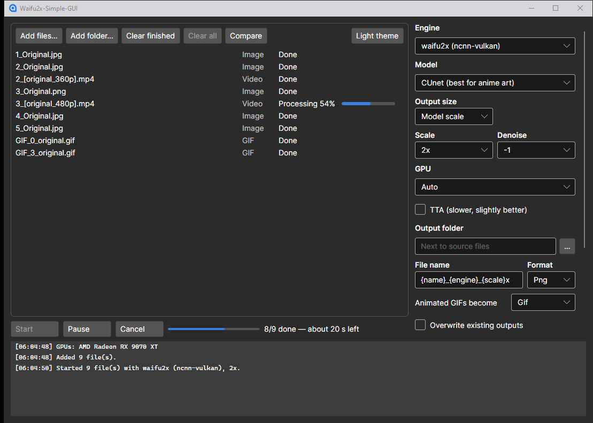

# Waifu2x-Simple-GUI

A fast, minimal, cross-platform GUI for ncnn-vulkan super-resolution engines:
waifu2x, Real-ESRGAN, Real-CUGAN, and RIFE frame interpolation for images, GIFs and videos.

Built with .NET 10 and Avalonia 12. Status: in development.



## Releases

Windows x64 and Linux x64 packages are self-contained: app, all four engines with models, ffmpeg/ffprobe.
Unpack and run `Waifu2x-Simple-GUI(.exe)`. Needs a Vulkan-capable GPU driver.
macOS isn't packaged (untested), but building from source may work.

## Build

```bash
dotnet build
dotnet test --project tests/Waifu2xSimpleGui.Core.Tests
dotnet run --project src/Waifu2xSimpleGui.App
```

Release package (downloads engines + ffmpeg, publishes Native AOT; build each RID on its own OS). Text files
and licenses go into `docs/` inside the package:

```bash
dotnet run build/package.cs -- --rid win-x64      # or linux-x64; --ffmpeg lgpl, --version 1.0.0
```

Output: `artifacts/release/`. Linux AOT needs `clang` and `zlib` dev headers.

## Engines (development)

For dev runs, put the engines into `engines/` — see [engines/README.md](engines/README.md) for the layout
and download links. ffmpeg/ffprobe are used from `engines/ffmpeg/` or PATH.

## License

Waifu2x-Simple-GUI is licensed under the [0BSD License](https://xn--gba.st/kawaiifiveo). Bundled engines, models and tools keep their own licenses: [docs/THIRD-PARTY.md](docs/THIRD-PARTY.md).
